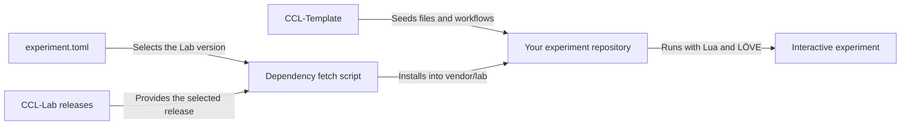

# CCL-Template

[](https://github.com/users/Broomfields/projects/5)
[](https://github.com/Broomfields/CCL-Template/commits/main/)
[](https://github.com/Broomfields/CCL-Template/blob/main/LICENSE)

The starting point for independent Creative Coding Lab experiments, built with Lua and LÖVE.

Creative Coding Lab combines a reusable platform with interactive experiments in simulation, visualisation, physics, mathematics, and computation. CCL-Template is being developed to supply the application structure, setup tools, and workflows for each new experiment.

## Development status

The repository is in its initial setup phase. The starter application and tooling described below are planned. Follow progress in the [Creative Coding Lab project](https://github.com/users/Broomfields/projects/5).

Verified setup commands and a runnable example will be added as the Template develops.

## Planned contents

- Application entry points, experiment state, model code, and control declarations.
- A version manifest and scripts to fetch the declared Lab release.
- Local validation and optional Busted tests for experiment code.
- An experiment notebook for questions, Cases, observations, and findings.
- Workflows for validation, dependency updates, and experiment releases.
- Desktop packaging and browser deployment through GitHub Pages.

## How it fits together

The intended setup gives each experiment its own repository and a versioned Lab dependency.



The experiment owns its model, state, and behaviour. Lab supplies shared runtime and presentation services. The manifest records the experiment version, Template provenance, and Lab dependency.

## Planned experiment structure

```text
your-experiment/
├── experiment.toml     Version and dependency metadata
├── main.lua            Application entry point
├── conf.lua            LÖVE configuration
├── experiment.lua      Experiment state and coordination
├── simulation.lua      Model calculations
├── controls.lua        Experiment controls
├── README.md           Introduction, setup, and running
├── EXPERIMENT.md       Questions, Cases, and findings
├── scripts/
│   └── fetch-lab.sh    Fetch the declared Lab release
└── vendor/
    └── lab/            Fetched runtime, ignored by Git
```

Adapt the structure to the experiment's needs. Experiments in the maintained CCL collection use the name `CCL-Exp-{Experiment_Name}`; choose a name that suits your own project.

## Documentation

- [Project introduction](https://github.com/Broomfields/CCL-Docs/blob/main/getting-started.md)
- [Developer architecture](https://github.com/Broomfields/CCL-Docs/blob/main/developer-architecture.md)
- [Coding standards](https://github.com/Broomfields/CCL-Docs/blob/main/coding-standards.md)
- [Shared Lab runtime](https://github.com/Broomfields/CCL-Lab)

## Help and feedback

Use [Template issues](https://github.com/Broomfields/CCL-Template/issues) for setup, starter files, and workflow improvements. Use [Lab issues](https://github.com/Broomfields/CCL-Lab/issues) for shared runtime bugs.

Questions and experiment ideas are welcome in [Lab Discussions](https://github.com/Broomfields/CCL-Lab/discussions).

## Credits

The planned experiment environment builds on these projects and their contributors:

- [Lua](https://www.lua.org/): The programming language for experiment and runtime code.
- [LÖVE](https://love2d.org/): The framework for graphics, audio, input, and application execution.
- [Busted](https://lunarmodules.github.io/busted/): The testing framework for Lua code.

## Licence

[MIT](https://github.com/Broomfields/CCL-Template/blob/main/LICENSE)
