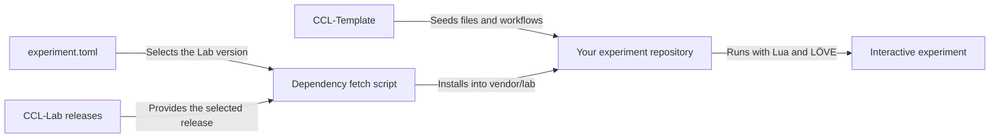

# CCL-Template

[](https://github.com/users/Broomfields/projects/5)
[](https://github.com/Broomfields/CCL-Template/commits/main/)
[](https://github.com/Broomfields/CCL-Template/blob/main/LICENSE)

CCL-Template is the starting structure for experiments in **Creative Coding Lab**, a platform I'm building for my own exploration and self-learning through programming.

I use these experiments to explore and visualise ideas I find in books and online. The Template is being developed to bring together the application files, Lab dependency setup, and workflows so I can get started on each idea more easily.

You're welcome to use it for your own experiments. The documentation records how the pieces fit together, with practical setup instructions added as the tooling develops.

## Development status

The repository contains the initial source and documentation skeleton. The Lua files reserve module responsibilities; they do not yet implement a runnable experiment or integrate Lab. Dependency fetching, version metadata, validation, and workflows are planned. Follow progress in the [Creative Coding Lab project](https://github.com/users/Broomfields/projects/5).

Verified setup commands and a runnable example will be added as the Template develops.

## Planned contents

- Application entry points, experiment state, model code, and control declarations.
- A version manifest and scripts to fetch the declared Lab release.
- Local validation and optional Busted tests for experiment code.
- An experiment notebook for ideas, explorations, and discoveries.
- Workflows for validation, dependency updates, and experiment releases.
- Desktop packaging and browser deployment through GitHub Pages.

## How it fits together

The intended setup gives each experiment its own repository and a versioned Lab dependency.



The experiment owns its model, state, and behaviour. Lab supplies shared runtime and presentation services. The manifest records the experiment version, Template provenance, and Lab dependency.

## Experiment structure

```text
your-experiment/
├── experiment.toml     Planned: version and dependency metadata
├── main.lua            Application entry point
├── conf.lua            LÖVE configuration
├── experiment.lua      Experiment state and coordination
├── simulation.lua      Model calculations
├── controls.lua        Experiment controls
├── README.md           Introduction, setup, and running
├── EXPERIMENT.md       Ideas, explorations, and discoveries
├── scripts/
│   ├── README.md       Tooling responsibilities and planned scripts
│   └── fetch-lab.sh    Planned: fetch the declared Lab release
├── .gitignore          Generated dependencies, builds, and run output
└── vendor/
    └── lab/            Created by future fetch tooling; ignored by Git
```

Adapt the structure to the experiment's needs. Experiments in the maintained CCL collection use the name `CCL-Exp-{Experiment_Name}`; choose a name that suits your own project.

## Documentation

- [Project introduction](https://github.com/Broomfields/CCL-Docs/blob/main/getting-started.md)
- [Developer architecture](https://github.com/Broomfields/CCL-Docs/blob/main/developer-architecture.md)
- [Coding standards](https://github.com/Broomfields/CCL-Docs/blob/main/coding-standards.md)
- [Shared Lab runtime](https://github.com/Broomfields/CCL-Lab)

## Help and feedback

Use [Template issues](https://github.com/Broomfields/CCL-Template/issues) for setup, starter files, and workflow improvements. Use [Lab issues](https://github.com/Broomfields/CCL-Lab/issues) for shared runtime bugs.

Questions and experiment ideas are welcome in [Lab Discussions](https://github.com/Broomfields/CCL-Lab/discussions).

## Credits

The planned experiment environment builds on these projects and their contributors:

- [Lua](https://www.lua.org/): The programming language for experiment and runtime code.
- [LÖVE](https://love2d.org/): The framework for graphics, audio, input, and application execution.
- [Busted](https://lunarmodules.github.io/busted/): The testing framework for Lua code.

## Licence

[MIT](https://github.com/Broomfields/CCL-Template/blob/main/LICENSE)
